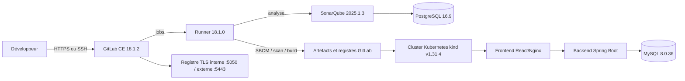

# Plateforme DevSecOps CAVOM

Ce dépôt contient **une application de démonstration** (React, Spring Boot et
MySQL), une pile locale GitLab CE/SonarQube/GitLab Runner, des modèles GitLab
CI, des manifests Kubernetes et des contrôles Trivy. Il ne s'agit pas d'une
installation de production clé en main : plusieurs réglages et secrets doivent
être fournis par un opérateur, et les écarts actuellement présents dans le code
généré sont explicités dans la documentation.

## Carte de lecture

- [Architecture et arbitrages](docs/architecture/README.md) : diagrammes,
  versions, réseaux, ports, ordre de démarrage et limites du dépôt ;
- [Installation](docs/installation/README.md) : commandes que l'opérateur devra
  exécuter ultérieurement, sans automatisme implicite ;
- [Configuration](docs/configuration/README.md) : variables, endpoints Maven,
  registre, SonarQube et préparation Kubernetes ;
- [Sécurité](docs/security/README.md) : contrôles CI, Runner/BuildKit, secrets,
  RBAC, réseau, registres et Quality Gate ;
- [Dépannage](docs/troubleshooting/README.md) : liste exacte des symptômes,
  diagnostics et corrections.

## Vue d'ensemble



Le PostgreSQL de la pile est **exclusivement la base SonarQube**. L'application
Kubernetes utilise MySQL, qui n'est pas créé par `docker-compose.yml`.

## Démarrage local : exécuté par un humain

Les commandes suivantes sont documentées mais n'ont pas vocation à être
exécutées par ce README :

```sh
cd infrastructure/docker
cp .env.example .env
cp runner/config.toml.example runner/config.toml
# Installer les certificats attendus dans gitlab/certs, remplacer les secrets
# et enregistrer le Runner dans GitLab.
docker compose --profile buildkit up -d
docker compose ps
```

Le profil `buildkit` est optionnel. Il lance un daemon BuildKit rootless ;
**il ne rend pas le Runner shell compatible avec les jobs `image:`** du
pipeline. Le dépôt propose aussi `config.docker-executor.toml.example`, mais
cette configuration suppose une API Docker rootless externe sur
`rootless-docker-endpoint:2376`, gérée hors de ce Compose, avec TLS et sans
socket Docker hôte. Consulter la section « Runner » de
[l'installation](docs/installation/README.md) avant d'attacher ce dépôt à un
Runner.

## Arborescence

```text
.
├── .gitlab-ci.yml
├── application/
│   ├── backend/                 # Spring Boot 3.3.7, Java 17, Maven
│   ├── database/init/           # schéma MySQL de démonstration
│   └── frontend/                # React 18.3.1, Vite 5.4.14, Nginx
├── ci-cd/
│   ├── scripts/                 # validation, build, Trivy, publication, déploiement
│   └── templates/               # étapes GitLab CI modulaires
├── docs/{architecture,installation,configuration,security,troubleshooting}/
├── infrastructure/
│   ├── docker/                  # GitLab CE, Runner, SonarQube, PostgreSQL, BuildKit
│   └── kubernetes/              # manifests Kustomize et scripts kind
└── security/
    ├── policies/                # politique CI et registre des exceptions
    └── trivy/                   # configuration et fichier d'ignorance
```

## Versions principales réellement épinglées

| Composant | Version ou référence |
|---|---|
| GitLab CE | `18.1.2-ce.0` |
| GitLab Runner | `v18.1.0` |
| SonarQube Community | `2025.1.3-community` |
| PostgreSQL SonarQube | `16.9-bookworm` |
| BuildKit (Compose) | `v0.23.2-rootless` |
| Scanner SonarQube CI | `11.2.2.18815` |
| Trivy CI | `0.58.1` |
| BuildKit CI | `v0.20.2-rootless` |
| kind / Kubernetes | nœud `v1.31.4` |
| MySQL applicatif | `8.0.36` |
| Spring Boot / Java | `3.3.7` / 17 |
| Frontend | React `18.3.1`, Vite `5.4.14` |
| kubectl / Skopeo CI | `1.32.3` / `v1.18.0` |

Les manifests applicatifs référencent la version `1.0.0`. La CI les remplace
par le tag Git ou `$CI_COMMIT_SHORT_SHA` avant rollout. Les scripts locaux
utilisent également `1.0.0` par défaut.

## Limites et préparation restantes

1. Le Runner fourni est un **shell executor non privilégié** ; les jobs CI qui
   déclarent une `image:` ne pourront pas être isolés/exécutés dans ces images
   sans adapter l'executor ou son environnement. L'alternative Docker ne
   contient pas de daemon : l'API rootless externe, ses certificats, son DNS et
   son alimentation en images/ressources doivent être opérés séparément.
2. GitLab exige quatre fichiers TLS non versionnés dans
   `infrastructure/docker/gitlab/certs` et une CA distribuée aux clients.
3. Le secret `database-credentials` et le secret de pull du registre restent des
   templates non inclus dans Kustomize et doivent être créés séparément.
4. Le registre est exposé en TLS sur `registry.localhost:5443`, avec l'endpoint
   interne TLS `gitlab:5050`. Ni les jobs Docker ni kind n'acquièrent
   automatiquement le routage, la confiance CA ou les credentials correspondants.
5. Le script CI vérifie l'existence des secrets avant `apply`, mais leurs
   valeurs, le kubeconfig au moindre privilège, le CNI et les pare-feu restent
   à préparer.

Ces conditions d'exploitation sont documentées sans attribuer au dépôt des
capacités externes qu'il ne fournit pas.
