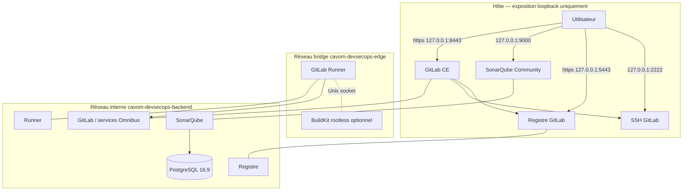
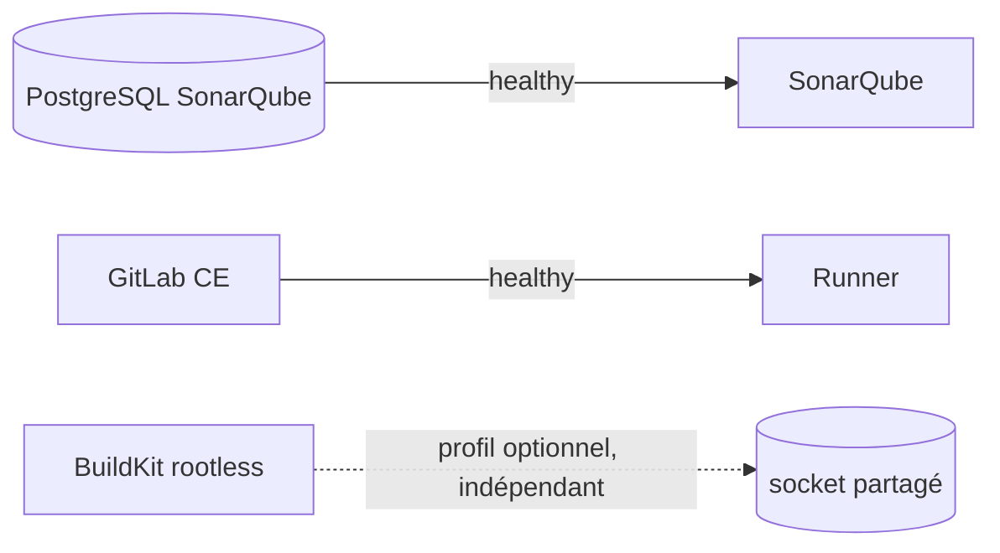
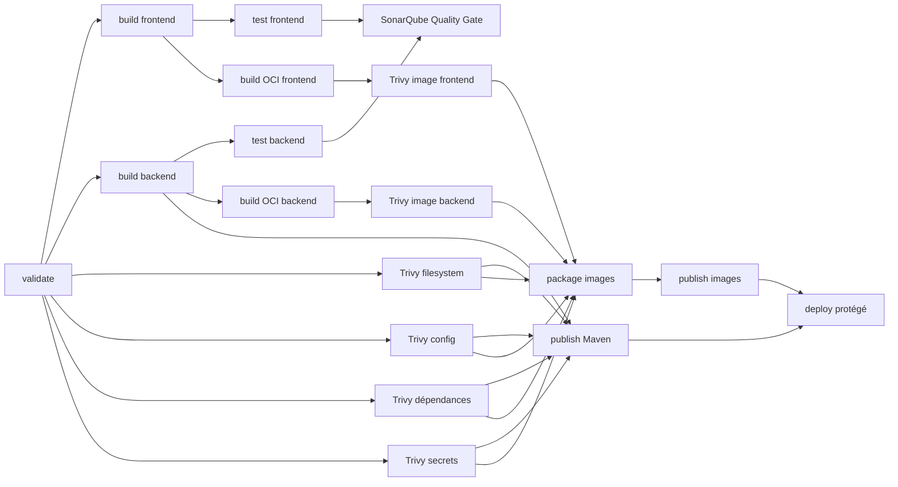
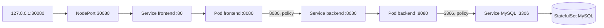

# Architecture

## Périmètre

Le dépôt associe trois plans distincts :

1. **socle local** sous Compose : GitLab, Runner, SonarQube et sa base
   PostgreSQL, avec BuildKit optionnel ;
2. **chaîne de livraison** GitLab CI : validation, compilation, tests, Quality
   Gate, scans, OCI, publication Maven/conteneurs et déploiement Kubernetes ;
3. **application** Kubernetes : frontend, backend et MySQL.

Ne pas confondre le PostgreSQL SonarQube avec MySQL : ils appartiennent à deux
plans différents et n'ont ni réseau, ni lifecycle, ni données en commun.

## Topologie Compose

`edge` peut sortir vers l'extérieur ; `backend` est un réseau Docker
`internal: true`. GitLab a les deux raccordements. SonarQube et PostgreSQL sont
sur `backend`, mais SonarQube est aussi sur `edge` pour la publication du port
9000. Le Runner est sur les deux réseaux. BuildKit, profil optionnel, est
uniquement sur `edge`.

### Ports et exposition

| Entrée | Port hôte | Port conteneur | Destination / observation |
|---|---:|---:|---|
| GitLab HTTPS | 8443 | 443 | loopback, certificats locaux |
| GitLab SSH | 2222 | 22 | loopback |
| Registre GitLab externe | 5443 | 5050 | loopback, TLS |
| Registre interne Compose | — | 5050 | endpoint TLS `gitlab:5050` sur réseaux Docker |
| SonarQube | 9000 | 9000 | loopback, HTTP sans TLS |
| Runner metrics | non publié | 9252 | loopback interne du conteneur |
| Frontend kind | 30080 | NodePort 30080 | mapping loopback kind |
| Frontend nginx image | — | 8080 | écoute réelle de Nginx |
| Frontend manifest | — | 8080 | port du conteneur/Nginx |
| Backend K8s | ClusterIP | 8080 | trafic interne |
| MySQL K8s | ClusterIP | 3306 | trafic backend uniquement |

## Ordre de démarrage

Pour Compose, les seuls ordres matériels codés dans
`depends_on` sont :

Le Runner partage le volume du socket BuildKit, mais son
`depends_on` ne vérifie pas la santé de BuildKit. GitLab effectue un démarrage
Omnibus long (grâce de 180 secondes dans le healthcheck). SonarQube a sa propre
grâce de 120 secondes et impose les contrôles Elasticsearch.

Pour kind, le script local applique tous les objets puis attend MySQL, le
backend et le frontend dans cet ordre. Cette attente ne remplace pas les
secrets absents de Kustomize ni la préparation du registre/CA.

## Pipeline CI

La publication Maven exige les scans filesystem, configuration, dépendances
et secrets. Le packaging des images exige les mêmes scans génériques ainsi
que les deux scans d'images. Le déploiement exige les deux publications. Le job Sonar est créé seulement si `SONAR_TOKEN` et
`SONAR_HOST_URL` sont présents ; il attend alors le verdict serveur de la
Quality Gate. Les jobs Maven/image/deploy ont des règles de branche/tag, pas
une garantie que tous les éditeurs de branche possèdent ces droits.

## Topologie Kubernetes

Trois namespaces portent les tiers : `cavom-frontend`, `cavom-backend` et
`cavom-database`. Chaque espace applique `default-deny` ingress/egress, puis
ouvre DNS, les liens stricts frontend/backend/base et le port frontend 8080
depuis `0.0.0.0/0`. Les policies ne valent que si le CNI de la cible les applique.

## Arbitrages actuels

| Choix | Bénéfice | Coût / limite |
|---|---|---|
| Runner shell, UID 1000, sans socket Docker | surface réduite, pas de daemon privilégié | les directives CI `image:` ne fournissent pas d'environnement |
| Executor Docker d'exemple | exécution des jobs dans leurs images | suppose une API rootless Docker externe `:2376`, TLS et certifs opérés hors dépôt |
| BuildKit rootless séparé | socket daemon moins risqué que Docker-in-Docker | seccomp/AppArmor relâchés pour ce seul service ; wrapper rootless à tester |
| Tout GitLab dans un conteneur Omnibus | démarrage simple pour laboratoire | non réparti ; sauvegarde/upgrade complexes et ressources élevées |
| SonarQube Community | analyse et Quality Gate locales | pas de fonctions Enterprise, portfolios ni PR GitLab enrichies |
| MySQL avec PVC | état applicatif persistant | sauvegarde, restauration et HA non fournies |
| Secrets hors Kustomize | pas de secrets en clair dans Git | déploiement incomplet sans mécanisme externe |
| Ports loopback | exposition locale réduite | proxy/TLS/DNS requis hors laboratoire |

## Préparation externe restante

- Installer les certificats GitLab/registry attendus, leur CA de confiance et
  les règles réseau/DNS ; ils ne sont pas versionnés.
- Créer `gitlab-regcred` dans les namespaces frontend/backend et
  `database-credentials` dans backend/database.
- Fournir une API Docker rootless réellement administrée si l'exemple d'executor
  Docker est choisi ; aucun daemon correspondant n'existe dans Compose et le
  socket hôte n'est pas le mécanisme prévu.
- L'image applicative K8s est épinglée `1.0.0`, puis la CI utilise un tag
  commit/tag. Le script local de kind peut encore remplacer cette valeur par
  `latest`.
- Le ConfigMap `mysql-init-schema` est inclus et monté dans
  `/docker-entrypoint-initdb.d`; il ne s'exécute qu'à l'initialisation d'un
  volume MySQL vide. Les migrations de versions ultérieures restent à opérer.
